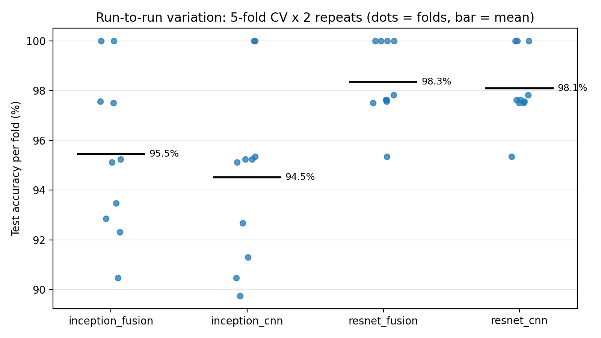

# Wall Material Condition Recognition: CNN–GLCM Feature Fusion on Limited Data

[](https://colab.research.google.com/github/Babatems/wall-material-cnn-glcm/blob/main/CNN_GLCM_Fusion.ipynb)

Image classification of **seven interior-wall construction conditions** (e.g. CMU wall, mesh, first- vs second-coat
plaster) from only **208 site photographs**. The project replicates the CNN–GLCM fusion model of
Mengiste et al. (2024), which combines a pretrained Inception V3 with gray-level co-occurrence matrix (GLCM) texture
features, and tests whether its results hold when the backbone is replaced by **ResNet-50**.

Course project, GACS-7205 Digital Image Processing, MSc in Applied Computer Science and Society, University of Winnipeg.

---

## Research objective

The original fusion result was obtained with a single backbone (Inception V3). This project asks:
**does CNN–GLCM fusion with a ResNet-50 backbone perform as well as with Inception V3 when everything else in the
pipeline is held constant — and does the GLCM texture branch actually help?**

| | Hypothesis |
|---|---|
| **H1** | For both backbones, CNN–GLCM fusion is more accurate than the same backbone without GLCM features. |
| **H2** | ResNet-50 fusion is non-inferior to Inception V3 fusion: its mean accuracy is no more than 3 percentage points lower. |

Aims: **A1** replicate the Inception V3 fusion model · **A2** swap in ResNet-50, changing only the backbone ·
**A3** remove the GLCM branch (ablation) · **A4** identify which conditions each model confuses.

## Repository structure

```
wall-material-cnn-glcm/
├── CNN_GLCM_Fusion.ipynb   # the complete workflow, Sections 1–16 (run top to bottom)
├── requirements.txt        # pinned package versions
├── data/
│   ├── README.md           # dataset source, license, download steps and expected layout
│   ├── sample/             # 2 example images per class (CC BY 4.0)
│   └── raw/                # full dataset goes here - not tracked by Git
├── results/                # every output of the reported run (predictions, tables, figures)
├── LICENSE                 # MIT (code only)
└── README.md
```

## Requirements

* Python 3.13 (tested on Google Colab); packages and versions in [`requirements.txt`](requirements.txt):
  PyTorch 2.14 / torchvision 0.29, scikit-image, scikit-learn, SciPy, statsmodels, pandas, Matplotlib, ImageHash.
* A GPU is strongly recommended for training (all results were produced on a free Colab **NVIDIA T4**).
  Re-creating the analysis from saved results does not need a GPU.

## Setup

### Option A — Google Colab (recommended)
1. Click **Open in Colab** above, then *Runtime → Change runtime type → T4 GPU*.
2. In Google Drive create `MyDrive/wall-material-project/` containing:
   * `data/raw/` — the dataset (see [Data](#data));
   * `results/` — a copy of this repository's `results/` folder (to re-create the analysis), **or** leave it out
     to re-train from scratch.
3. Section 1 mounts Drive and installs the packages missing from Colab. If you use a different Drive folder,
   change `PROJECT_DIR` in Section 2.

### Option B — local machine
```bash
git clone https://github.com/Babatems/wall-material-cnn-glcm.git
cd wall-material-cnn-glcm
python -m venv .venv
source .venv/bin/activate          # Windows: .venv\Scripts\activate
pip install -r requirements.txt    # for a CUDA build of PyTorch see pytorch.org/get-started/locally
# put the dataset in data/raw/ (see below), then:
jupyter lab CNN_GLCM_Fusion.ipynb
```
Start Jupyter from the repository root: the notebook uses it as `PROJECT_DIR`.

## Data

Public dataset by Mengiste, Mannem, Prieto & García de Soto (2023), Mendeley Data,
DOI [10.17632/zv66h54b8j.1](https://doi.org/10.17632/zv66h54b8j.1), license **CC BY 4.0**.
208 JPEG photographs from one construction site, in 7 class folders (24–49 images per class).

Download it, unzip it, and place the seven class folders in `data/raw/`. Full instructions, class counts and the
exact folder layout are in [`data/README.md`](data/README.md). Two example images per class are in `data/sample/`.

## How to run

Run the notebook **top to bottom**. Each training run saves its predictions to `results/` and is **skipped** if that
file already exists, so an interrupted session can simply be restarted from Section 1.

| Goal | What to do | Time (T4) |
|---|---|---|
| **Re-create all tables and figures** | Keep the repository's `results/` folder and run every section. Sections 10 and 14 skip all runs; Section 9 can be skipped. | a few minutes |
| **Re-train everything** | In Section 2 set `RESULTS_DIR` to a new, empty folder (e.g. `results_rerun`). The split and CV folds are regenerated from fixed seeds. | ≈ 3 hours |

| Section | What it does | Main output |
|---|---|---|
| 1 | Environment check, Drive mount (Colab), package install | – |
| 2 | All settings in one `CONFIG` dictionary | `config.json` |
| 3 | Loads images, checks 208 images / 7 classes, shows samples | – |
| 4 | Fixed stratified 80/20 split (mirrors the paper's protocol) | `split.csv` |
| 5 | GLCM texture features (72 per image) | `glcm_features.npy` |
| 6–8 | Augmentation, model (`FusionNet`) and training functions | – |
| 9 | Quick test: one Inception fusion run (≈2.5 min) | printed report |
| 10 | Fixed split: 4 configurations × 5 seeds (20 runs, ≈50 min) | `pred_<config>_seed<n>.csv` |
| 11–12 | Fixed-split summary, per-class F1, confusion matrices, McNemar | `summary.csv`, `per_class_f1.csv`, `confusion_matrices.png`, `mcnemar.csv` |
| 13 | Near-duplicate check with perceptual hashing | `near_duplicates.csv` |
| 14 | Repeated stratified group 5-fold CV, 2 repeats (40 runs, ≈1.5–2 h) — **main analysis** | `cv_folds.csv`, `cv_pred_<config>_r<r>_f<f>.csv` |
| 15 | CV summary, corrected-t confidence intervals and H1/H2 decisions, McNemar | `cv_summary.csv`, `cv_fold_scores.csv`, `cv_hypothesis_tests.csv`, `cv_mcnemar.csv` |
| 16 | Figures | `cv_variation.png`, `cv_confusion_two.png`, `examples_*.png` |

## Important parameters

All parameters are set in Section 2 and saved to `results/config.json`. The original paper reports the architecture
dimensions and the 80/20 split; the remaining values were not reported and are this project's choices.

| Group | Setting |
|---|---|
| Backbones | ImageNet-pretrained Inception V3 (299 px input) and ResNet-50 (224 px), each at its native input size |
| Fusion head (from the paper) | CNN features → 1024; GLCM → 256; concatenated (1280) → 256 → 7 classes; dropout 0.3 |
| GLCM | grayscale, resized to 256 × 256, 64 gray levels; distances 1, 2, 3 px; angles 0°, 45°, 90°, 135°; contrast, dissimilarity, homogeneity, energy, correlation, ASM → 72 features, standardised on training data only |
| Training | AdamW, batch 16; 15 epochs with the backbone frozen (lr 1e-3), then 15 epochs fine-tuning its last block (lr 1e-4); weight decay 1e-4; fixed epochs, no test-based model selection |
| Augmentation (training only) | random crop 80–100 %, horizontal flip, rotation ±15°, brightness/contrast ±20 % |
| Evaluation | fixed split: 5 seeds; CV: 5 folds × 2 repeats, stratified by class and grouped by near-duplicates |
| Decision rules | 95 % CIs from the Nadeau & Bengio (2003) corrected resampled t-test; H2 non-inferiority margin 3 percentage points (committed before CV was run) |

Prediction files contain one row per test image: `path` (class folder/file name), `y_true`, `y_pred`
(class indices in alphabetical order of the class names).

## Results

**Main analysis — repeated cross-validation** (every image tested twice; mean ± SD over 10 folds):

| Configuration | Accuracy | Macro-F1 |
|---|---|---|
| Inception V3, CNN only | 94.5 ± 3.6 % | 0.938 ± 0.042 |
| Inception V3 + GLCM (paper's model) | **95.5 ± 3.3 %** | 0.946 ± 0.043 |
| ResNet-50, CNN only | 98.1 ± 1.5 % | 0.980 ± 0.015 |
| ResNet-50 + GLCM | **98.3 ± 1.6 %** | 0.982 ± 0.016 |

| Test | Difference in accuracy (95 % CI) | Decision |
|---|---|---|
| H1, Inception: fusion − CNN only | +0.9 pts (−2.8, +4.7) | no clear difference |
| H1, ResNet-50: fusion − CNN only | +0.25 pts (−0.8, +1.3) | no clear difference |
| H2: ResNet-50 fusion − Inception fusion | +2.9 pts (−2.75, +8.5) | non-inferior (H2 supported) |

* **Replication:** the Inception V3 fusion model reaches 95.5 %, consistent with the 95 % reported by Mengiste et al.
* **H1 not supported:** adding GLCM features gave no measurable gain for either backbone.
* **H2 supported:** ResNet-50 is non-inferior to Inception V3 (narrowly, by the 3-point margin) and more stable
  across folds; its superiority is not established.
* The single fixed 42-image split (Sections 10–12) gave quite different numbers (e.g. Inception fusion 89.5 %),
  which is why cross-validation is the main analysis.



## Limitations

* **Small, single-site dataset:** 208 images from one building; results may not transfer to other sites, lighting or finishes.
* **Unreported settings:** GLCM parameters, augmentation and training hyperparameters were not reported in the
  original paper, so this is a replication of the method, not of its exact code. The paper's train/test split is not
  available either.
* **Near-duplicates:** perceptual hashing found 22 near-identical pairs (30 images); 5 pairs fall across the fixed
  80/20 split, so the fixed-split results contain some leakage. The CV folds keep every group together. Hashing does
  not detect different photos of the same wall area.
* **Backbone differences beyond architecture:** the ResNet-50 weights (torchvision `IMAGENET1K_V2`) come from a
  stronger training recipe than the Inception V3 weights (`IMAGENET1K_V1`), and the fine-tuned last blocks differ in size.
* **Reproducibility on GPU:** seeds are fixed and cuDNN is set to deterministic mode, but results can still differ
  slightly across GPU types and library versions.
* Prediction files from the original run store full Colab paths; the notebook matches images by class folder and
  file name, so they load on any machine.

## License and citation

Code: MIT License (see `LICENSE`). Data: CC BY 4.0, © the dataset authors — not covered by the MIT license.

If you use this work, please cite the original study and dataset:

* Mengiste, E., Mannem, K. R., Prieto, S. A., & García de Soto, B. (2024). Transfer-learning and texture features for
  recognition of the conditions of construction materials with small data sets. *Journal of Computing in Civil
  Engineering, 38*(1), 04023036. https://doi.org/10.1061/JCCEE5.CPENG-5478
* Mengiste, E., Mannem, K. R., Prieto, S. A., & García de Soto, B. (2023). *Dataset of images for model development
  using transfer-learning and texture features recognition of the conditions of construction materials with small
  datasets* (Version 1) [Data set]. Mendeley Data. https://doi.org/10.17632/zv66h54b8j.1
* Nadeau, C., & Bengio, Y. (2003). Inference for the generalization error. *Machine Learning, 52*(3), 239–281.

## Author and acknowledgments

**Temiloluwa Inumoh** — MSc in Applied Computer Science and Society, University of Winnipeg ·
GitHub [@Babatems](https://github.com/Babatems)

Thanks to Mengiste et al. for publishing their dataset openly, and to the course instructor and classmates whose
proposal feedback led to the cross-validation and non-inferiority analysis.
